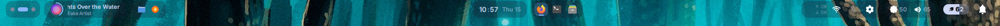
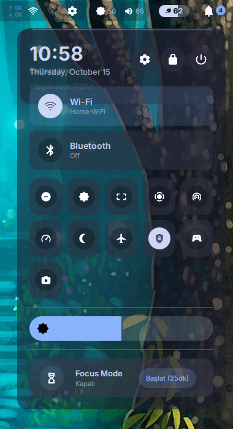
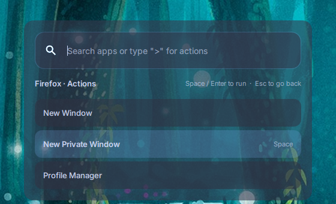
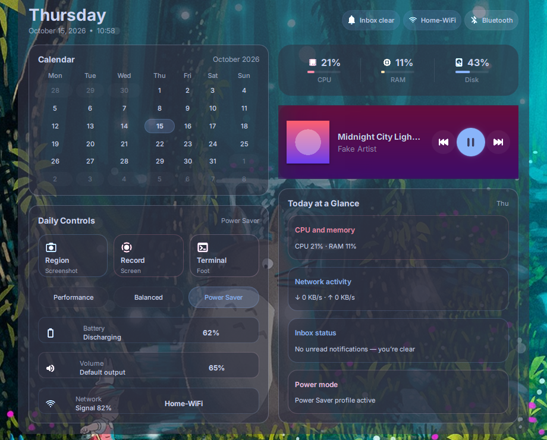

# qs-niri

A One UI 8 style desktop shell for the [niri](https://github.com/YaLTeR/niri) Wayland compositor, written in QML on top of [Quickshell](https://quickshell.org). It provides a top bar, launcher, Control Center, notification center, dashboard, task manager, lock screen and an optional greetd login screen, with Material You colors generated from your wallpaper by matugen.

This is a fork of [tripathiji1312/quickshell](https://github.com/tripathiji1312/quickshell) (MIT). The Hyprland support of the original was dropped; niri is the only supported compositor.

## Contents

- [Features](#features)
- [Screenshots](#screenshots)
- [Requirements](#requirements)
- [Installation](#installation)
- [Profiles](#profiles)
- [Configuration](#configuration)
- [Feature guide](#feature-guide)
- [Keybinds and toggle files](#keybinds-and-toggle-files)
- [Theming](#theming)
- [Project layout](#project-layout)
- [Continuous integration](#continuous-integration)
- [Troubleshooting](#troubleshooting)
- [Status and known limitations](#status-and-known-limitations)
- [License](#license)

## Features

- Top bar with workspaces, clock, media pill, system tray, connectivity icons, a keyboard layout pill (TR/EN, shown with two or more niri layouts; click switches; Settings > Shell > Keyboard edits the list via an included niri KDL file), battery, optional live network speed and optional open-window taskbar.
- Application launcher with desktop actions (new window, private window, ...).
- Control Center with Wi-Fi, Bluetooth, Hotspot, Do Not Disturb, Gaming mode, screen recording, speed test, Night Light, Airplane mode and VPN tiles, plus volume and brightness sliders.
- Notification server, notification history sidebar, volume and brightness OSD.
- Dashboard, system tools panel, task manager, clipboard history, Wi-Fi QR panel for the hotspot.
- Gaming mode: performance power profile, Do Not Disturb and no idle lock/sleep, switched on by hand or automatically when a game is focused.
- Real session lock screen (ext-session-lock-v1, PAM) and a matching greetd login screen.
- Three profiles (`minimal`, `base`, `bloated`) that decide which features are loaded.
- Nix flake with Home Manager and NixOS modules.

## Screenshots

Taken by the CI pipeline in headless Sway with fake media and tray data (bloated profile), cropped to the shell's own surfaces. Compositor blur is not available there, so panels look more transparent than they do on niri.



| Control Center | Launcher actions |
|---|---|
|  |  |



## Requirements

| Component | Notes |
|---|---|
| niri 26.04 or newer | Needed for compositor blur through ext-background-effect-v1. Older versions work without blur. |
| Quickshell 0.3.1 or newer | Built against Qt 6.10. |
| matugen (optional) | Material You colors from your wallpaper. Without it the shell keeps a Catppuccin Mocha palette. |
| NetworkManager, BlueZ, WirePlumber / PipeWire, UPower | Network, Bluetooth, audio and battery. |
| power-profiles-daemon | Gaming mode. |
| wl-clipboard, cliphist | Clipboard history. |
| gpu-screen-recorder | Screen recording. |
| wlsunset, util-linux (rfkill), qrencode, playerctl | Night Light, Airplane mode, hotspot QR, media control. |
| Papirus icon theme | Application and tray icons. |

Only the tools of features you enable are needed. The Nix module installs the right set for the chosen profile.

## Installation

### Nix (recommended)

Add the flake and import the Home Manager module:

```nix
{
  inputs.qs-niri.url = "github:dpentx/qs-niri/oneui8-adapt";

  # inside your Home Manager configuration
  imports = [ inputs.qs-niri.homeManagerModules.default ];
  programs.qs-niri = {
    enable = true;
    profile = "base";
    settings = {
      launcher.favorites = [ "firefox" "kitty" ];
      gaming.appIds = [ "^heroic" ];
    };
  };
}
```

Options:

| Option | Meaning |
|---|---|
| `enable` | Install the shell and write its configuration. |
| `profile` | `minimal`, `base` or `bloated`. Also selects which runtime tools are installed. |
| `settings` | Attrset written to `~/.config/quickshell/shell.json`. Omitted keys keep their defaults. |
| `package`, `quickshell` | Override the shell sources or the Quickshell package. |
| `installDependencies` | Install the runtime tools (wl-clipboard, playerctl, gpu-screen-recorder, Papirus, ...). |
| `autostart` | Start the shell as a systemd user service. |

The optional NixOS module configures greetd (see [Login screen](#login-screen)).

### Manual

```sh
git clone https://github.com/dpentx/qs-niri.git ~/.config/quickshell
cd ~/.config/quickshell
```

Install the tools from [Requirements](#requirements), then start the shell from niri's `config.kdl`:

```kdl
spawn-at-startup "quickshell"
```

Quickshell reloads the shell automatically when files change. To restart it by hand: `pkill quickshell; quickshell &`.

Fonts: the shell uses "OneUI Sans" when installed and falls back to the configured `appearance.fontFamily`. The font is not redistributed here; `scripts/install-oneui-font.sh` installs it from a source you provide.

### Wallpaper

The wallpaper panel uses `scripts/mw-tool` (a small helper built from `scripts/mw-tool.go`, rebuild with `scripts/build-mw-tool.sh`). `scripts/restore-wallpaper.sh` restores the last wallpaper at login.

## Profiles

The `profile` key in `shell.json` (or `programs.qs-niri.profile` in Nix) picks which features are switched on. Default: `base`. Features that are off are not loaded at all.

| Feature | minimal | base | bloated |
|---|:-:|:-:|:-:|
| `gaming` (pill, tile, auto detection) | | x | x |
| `recording` (tile, red pill) | | x | x |
| `hotspot` (tile, bar icon, QR panel) | | x | x |
| `speedtest` (page, tile, Ethernet action) | | x | x |
| `taskManager` | | x | x |
| `clipboard` (cliphist watcher) | | x | x |
| `lock` (lock screen) | | x | x |
| `files` (file manager) | | x | x |
| `quickToggles` (Night Light, Airplane, VPN) | | | x |
| `netSpeed` (up/down speed in the bar) | | | x |
| `taskbar` (open-window icons) | | | x |
| `wallSwitch` (quick wallpaper switcher) | | | x |

Override single switches:

```json
{ "profile": "minimal", "features": { "clipboard": true } }
```

## Configuration

Settings live in `~/.config/quickshell/shell.json`. The file is watched and changes apply immediately; keys you omit use the defaults below. The repository's `shell.json` is a sample.

A second file, `~/.config/quickshell-local/user.json`, is layered on top of `shell.json` and wins. The settings panel writes only to it, so it works even when `shell.json` is a read-only Nix store link. Objects merge key by key; delete the file (or use "Reset to defaults" in the panel) to go back to `shell.json` alone.

| Key | Default | Description |
|---|---|---|
| `profile` | `"base"` | `minimal`, `base` or `bloated`. |
| `features.<name>` | from profile | Override one feature switch. |
| `appearance.fontFamily` | `"OneUI Sans"` | UI font. |
| `appearance.materialIconFont` | `"Material Design Icons"` | Fallback glyph font. |
| `theme.mode` | `"dark"` | `dark`, `light` or `smart` (matugen picks from the image). |
| `theme.scheme` | `"scheme-tonal-spot"` | Any matugen scheme type, for example `scheme-vibrant` or `scheme-expressive`. |
| `theme.image` | `""` | Image or video themed at start-up when it differs from the last wallpaper. |
| `paths.screenshotsDir` | `~/Pictures/Screenshots` | Screenshot output. |
| `osd.volumeTimeoutMs`, `osd.brightnessTimeoutMs` | `2000` | OSD display time. |
| `notifications.popupWidth` | `420` | Popup width. |
| `notifications.maxVisible` | `5` | Popups shown at once. |
| `notifications.timeoutMs` | `7000` | Default timeout. |
| `notifications.registerServer` | `true` | Act as the notification daemon. Set to `false` to keep another daemon. |
| `notifications.spacing`, `notifications.margin` | `8` | Layout. |
| `launcher.enabled` | `true` | Enable the launcher. |
| `launcher.width`, `launcher.maxResults` | `720`, `40` | Size and result count. |
| `launcher.terminalCommand` | `["foot"]` | Terminal used for terminal apps. |
| `launcher.favorites` | list of common apps | Desktop IDs shown first. |
| `sidebar.enabled`, `.width`, `.margin`, `.maxHistory` | `true`, `420`, `12`, `80` | Notification history. |
| `dashboard.enabled`, `.width`, `.height`, `.margin` | `true`, `620`, `460`, `12` | Dashboard. |
| `gaming.autoDetect` | `true` | Follow the focused window. |
| `gaming.appIds` | `[]` | Extra regexes matched against the focused app_id. |
| `gaming.dnd` | `true` | Enable Do Not Disturb while gaming. |
| `gaming.inhibitIdle` | `true` | Keep the screen awake (no idle lock/sleep) while gaming. |
| `gaming.boostBrightness` | `false` | Raise brightness while gaming. |
| `gaming.graceSeconds` | `6` | Delay before leaving gaming mode. |
| `taskbar.enabled` | from profile | Open-window icons in the bar. |
| `taskbar.maxItems` | `8` | Maximum icons. |
| `bar.widgets` | `[]` | Ids of the extra bar pills, in order (see Bar widgets). |
| `bar.custom` | `[]` | Your own widgets: `id`, `exec`, and optional `label`, `icon`, `interval`, `onClick`. |
| `lock.pamService` | `"login"` | File in `/etc/pam.d` used for authentication. |
| `lock.idleMinutes` | `0` | Lock after this many idle minutes, `0` disables. |
| `lock.wallpaper` | wallpaper of the palette | Image shown on the lock screen. |

## Feature guide

### Settings panel

The system tools window (`qs-systools`) has a "Shell" tab: profile, every feature switch, idle lock time and the gaming auto-detect and Do Not Disturb options. Changes apply immediately and are saved to `user.json`. Lists such as `gaming.appIds`, the launcher favorites and appearance still need `shell.json` (or `user.json` by hand).

### Launcher

Opens with the `qs-launcher` toggle. Type to search. Hold Shift or Ctrl on an application to list its desktop actions (new window, private window, ...); arrow keys or the mouse select, Space or Enter runs.

### Bar and tray

The tray shows status icons. Right-click or Shift+click an icon to open its menu. Right-click used to crash Quickshell through a Qt context-menu bug that newer Qt versions fixed; if it still crashes for you, use Shift+click.

The media pill shows the current player's title and controls (MPRIS).

### Bar widgets

Extra pills left of the right-hand group, chosen and ordered in the settings panel (Shell tab, "Bar widgets": add, move up or down, remove). Built in: `cpu`, `memory`, `disk`, `gpu` (hidden without a supported GPU); clicking one opens the task manager. Your own widgets run a shell command and show the first line of its output:

```json
"bar": {
  "widgets": ["cpu", "memory", "uptime"],
  "custom": [
    { "id": "uptime", "label": "Uptime", "icon": "mdi_console", "exec": "uptime -p | sed s/up.//", "interval": 60, "onClick": "foot -e htop" }
  ]
}
```

`interval` is in seconds (default 30), `icon` is a file name from `assets/icons/oneui/`, `onClick` runs on click. Commands run as you, so only put commands you trust in `shell.json`. Desktop widgets are not implemented yet.

### Control Center

Tiles adapt to the hardware and profile. Wi-Fi and Hotspot appear only if a Wi-Fi adapter exists. Without one, the bar shows only an Ethernet icon that opens the speed test page; with Wi-Fi, the speed test is a Control Center tile.

### Network and quick toggles

- Hotspot: the bar shows a hotspot icon only while it is on. Clicking it opens a QR panel (needs `qrencode`) with SSID and password. The password is generated once and stored in the `qs-hotspot` NetworkManager profile.
- Night Light uses `wlsunset` at a fixed color temperature of about 4000 K.
- Airplane mode runs `rfkill block all`.
- VPN uses the first NetworkManager VPN or WireGuard profile and is hidden if there is none.
- Live upload and download speed (all interfaces) appears left of the connectivity icons in the bloated profile.

### Gaming mode

Switches power-profiles-daemon to `performance` (no sudo needed) and turns on Do Not Disturb. Toggle it from the Control Center, the bar pill, or let it follow the focused window. Detected as games: `steam_app_<id>`, `gamescope` and Wine `*.exe` app_ids, plus anything matching `gaming.appIds`.

```json
"gaming": {
  "autoDetect": true,
  "appIds": ["^heroic", "^minecraft"],
  "dnd": true,
  "boostBrightness": false,
  "graceSeconds": 6
}
```

### Screen recording

Toggle with `qs-record`, the Control Center tile or the red bar pill. Uses `gpu-screen-recorder`.

### Task manager

Opens with `qs-taskmanager`. Lists processes with CPU and memory use and offers kill buttons.

### Emoji picker

Own popup, opened with `qs-emoji` (e.g. `Mod+Period`). It lists all Unicode emoji (1914, without skin-tone variants) in category tabs like a phone keyboard: recent, smileys and people, animals, food, places, activities, objects, symbols, flags. Search matches English and Turkish names and keywords (the keyword data is bilingual, the interface is English); Enter in the search field copies the first result, a click copies with `wl-copy`. The last 32 used emoji are kept in `user.json`.

Font: if `assets/fonts/oneui8-emoji.ttf` exists it is used first, and anything it lacks falls back through fontconfig (Noto Color Emoji; the Nix module installs it). The font is not part of this repository; add it yourself if you have the right to use it. The emoji list is generated by `scripts/gen-emoji-data.py` (see its header for the npm packages it reads).

### Clipboard history

Needs `cliphist` and `wl-clipboard`; the shell starts the watcher. Open the popup with `qs-clipboard`.

### Taskbar

`"taskbar": { "enabled": true, "maxItems": 8 }` shows an icon per open window right of the clock. Click focuses, middle-click closes, Shift+click lists the app's desktop actions plus "Close window".

### Screenshots

The screenshot service supports region, screen and window modes. The window mode calls niri's `screenshot-window` action. Output goes to `paths.screenshotsDir`.

### Lock screen

A real session lock (ext-session-lock-v1), so niri covers every output until PAM accepts the password. It shows a blurred wallpaper, clock, user and a password field.

- Lock with `touch /tmp/qs-lock`, from the Control Center or from the power menu. The file only ever locks; unlocking needs the password.
- `lock.idleMinutes` greater than 0 locks on idle.
- If the shell crashes or reloads while locked, niri keeps the screen locked and a marker in `$XDG_RUNTIME_DIR` makes the next shell start lock again.

Test the lock with a second session or a TTY available. If PAM rejects your password you stay locked out of the screen (a TTY login still works).

### Login screen

`greeter.qml` is a One UI login screen for greetd using Quickshell's greetd support, with the same look as the lock screen. It runs inside `cage`.

With the NixOS module:

```nix
imports = [ inputs.qs-niri.nixosModules.default ];
programs.qs-niri-system = {
  enable = true;
  profile = "bloated";          # bloated: One UI greeter; minimal and base: tuigreet
  greeter.user = "kullanici";   # prefilled user name
  greeter.wallpaper = ./wall.png;
  # greeter.command = "niri-session";
  # greeter.enable = false;     # keep your own greetd configuration
};
```

Without Nix, set greetd's `default_session` command to:

```
cage -s -d -- env QS_GREETER_USER=<user> quickshell -p /path/to/qs-niri/greeter.qml
```

Environment variables: `QS_GREETER_USER` (prefilled user), `QS_GREETER_CMD` (session command, default `niri-session`), `QS_GREETER_WALLPAPER` (image path). The greeter uses the default palette (the greeter user has no generated palette) and a single monitor.

### Floating panels

Floating panels (Mod+S tools, files, dashboard, task manager, speedtest, hotspot): drag the pill on the top edge to move, the corner grip to resize; hold Ctrl and drag with the right button: the panel is split into a 3x3 compass grid and the zone under the pointer (N, NE, E, SE, S, SW, W, NW) picks the edge you pull. Double-click the pill to reset.

## When something breaks

If `shell.json` or `user.json` cannot be read, or Quickshell left a crash report from the last session, the shell shows a popup with a "Report issue" button. It opens a GitHub issue with the error, the shell commit and the Quickshell version filled in (home directories are replaced by `~`; nothing from your config files is added). Settings > Shell > About shows the same version information.

## Keybinds and toggle files

Every surface toggles when its file is touched, so any compositor can bind keys to it. Example for niri's `config.kdl`:

```kdl
binds {
    Mod+D             { spawn "touch" "/tmp/qs-launcher"; }
    Mod+V             { spawn "touch" "/tmp/qs-clipboard"; }
    Mod+L             { spawn "touch" "/tmp/qs-lock"; }
    Ctrl+Shift+Escape { spawn "touch" "/tmp/qs-taskmanager"; }
    Mod+Shift+R       { spawn "touch" "/tmp/qs-record"; }
    Alt+Z             { spawn "touch" "/tmp/qs-wallswitch"; }  // bloated: quick wallpaper switcher, Tab steps on
}
```

| File | Surface |
|---|---|
| `/tmp/qs-launcher` | Launcher |
| `/tmp/qs-controlcenter` | Control Center |
| `/tmp/qs-sidebar` | Notification sidebar |
| `/tmp/qs-dashboard` | Dashboard |
| `/tmp/qs-systools` | System tools |
| `/tmp/qs-taskmanager` | Task manager |
| `/tmp/qs-speedtest` | Speed test |
| `/tmp/qs-clipboard` | Clipboard history |
| `/tmp/qs-emoji` | Emoji picker |
| `/tmp/qs-media` | Media player popup |
| `/tmp/qs-files` | File manager (tabs: Ctrl+T / Ctrl+W / Ctrl+PageUp/Down, middle-click a folder; drag items onto a folder, a place or a tab to move them, hold Ctrl to copy; Ctrl+Z undoes; click the path bar or Ctrl+L to type a path; same-name files ask Replace / Skip / Keep both; long copies show a progress notification, using `pv` for files and `rsync` for folders when installed, plain `cp` otherwise) |
| `/tmp/qs-hotspotqr` | Hotspot QR panel (also picks up a hotspot started outside the shell: an access-point profile in NetworkManager, or a running systemd unit named like `hotspot`/`hostapd`/`create_ap`) |
| `/tmp/qs-wallswitch` | Quick wallpaper switcher (bloated profile): first touch opens it, every further touch steps to the next image, Enter applies, Esc closes. Bind e.g. `Alt+Z { spawn "touch" "/tmp/qs-wallswitch"; }` (niri has no key chords, so Alt+Z opens it and Tab, with Alt still held or not, steps on) |
| `/tmp/qs-lock` | Lock screen (lock only) |
| `/tmp/qs-record` | Screen recording |

## Theming

The shell follows One UI's hierarchy and visual language, adapted for a desktop. The numeric values are tuned for this project and are not official Samsung specifications.

- Colors: role tokens from `services/Pywal.qml` (`primary`, `onPrimary`, `popupSurface`, `panelBackground`, `tileOn`, `tileOff`, `error`, ...). The singleton keeps its old name; its palette comes from matugen (Material roles are mapped to the color slots in `applyRoles`) and defaults to Catppuccin Mocha until one is generated. Picking a wallpaper in the wallpaper panel re-themes the shell, and matugen runs any templates from `~/.config/matugen/config.toml` at the same time. Do not use raw `colorN` entries as roles or add hex fallbacks.
- Radius: `Appearance.radius` has `xs 4`, `s 8`, `m 12`, `l 16`, `xl 22`.
- Sizing and borders: `Appearance.size` and `Appearance.border`.
- Motion and state layers: `components/effects/OneUIMotion.qml`.
- Icons: `OneUIIcon { name: "<file>" }`, an SVG name without extension from `assets/icons/oneui/`. Icons missing from that set live beside it as `mdi_*.svg` (Material Design Icons, Apache-2.0).
- Blur: panels request compositor blur through ext-background-effect-v1 (`Appearance.blur`, set to `false` in `config/Appearance.qml` to disable). Strength is the compositor's setting; in niri 26.04+ tune it in `config.kdl` with `blur { passes 4; offset 4 }`. niri's blur only samples the wallpaper by default (xray), so a panel over an app or another panel shows the wallpaper through it; for real blur of everything below add to `config.kdl`: `layer-rule { match namespace="^quickshell"; background-effect { xray false; } }` (costs more GPU time).
- Interactive controls need hover, pressed and keyboard-focus states (focusable, Enter/Space activation, focus ring).

## Project layout

```text
shell.qml        shell entry point
greeter.qml      greetd login screen entry point
shell.json       sample user settings
settings.json    persisted UI state (used by services/Settings.qml)
assets/          icons, images, shaders
components/      reusable QML controls and effects
config/          Config singleton and design tokens
modules/         shell features (bar, launcher, controlcenter, lock, ...)
services/        system integrations and state (Network, Toggles, Clipboard, ...)
scripts/         wallpaper helper, theme and font installers
nix/             Home Manager and NixOS modules
flake.nix        flake outputs
```

Keep feature logic in `modules/`, system access in `services/`, and extend existing controls from `components/`. Singletons must be listed in `services/qmldir`, components in `components/qmldir`.

## Continuous integration

A GitHub Actions pipeline builds the shell with Nix, runs it in headless Sway, takes screenshots with grim and publishes them to the orphan branch `ci-screenshots`. A second workflow evaluates the Nix modules for every profile. These checks catch QML load errors and Nix evaluation errors; they cannot click, type or test hardware.

## Troubleshooting

Colors or theme not applied: matugen must be installed. Pick a wallpaper in the wallpaper panel, or set `theme.image` in `shell.json`, and look for a `Pywal` warning in the Quickshell log. The last palette is cached in `~/.cache/qs-niri/theme.json`.

Duplicate or conflicting notifications: set `notifications.registerServer` to `false` if another daemon should stay primary.

Bluetooth, network or audio controls do nothing: check `systemctl --user status wireplumber`, `systemctl status NetworkManager` and `systemctl status bluetooth`.

A tile or pill is missing: it is probably off in your profile, or the hardware or tool is absent (no Wi-Fi adapter, no VPN profile, no `cliphist`). See [Profiles](#profiles).

QML errors: run `quickshell` from a terminal and read its log.

## Status and known limitations

The shell is usable but not finished. CI verifies that it loads and renders; the following has not been tested on real hardware:

- PAM unlock, real greetd login with cage, multi-monitor greeter.
- Hotspot, VPN, rfkill, Night Light, screen recording, kill buttons, GPU tile.
- Game detection with real games.
- The Home Manager and NixOS modules on a real system (only evaluated in CI).

Not implemented: right-click menus on app icons, fingerprint unlock. Locking on `loginctl lock-session` and on suspend listens to logind through `dbus-monitor` (needs the `dbus` tools) and is untested on real hardware; the suspend lock holds no delay inhibitor, so on a very fast suspend the lock screen may appear only on wake.

## License

MIT, see [LICENSE](LICENSE). Original work copyright Swarnim Tripathi; One UI adaptation and additions by the fork's author.
